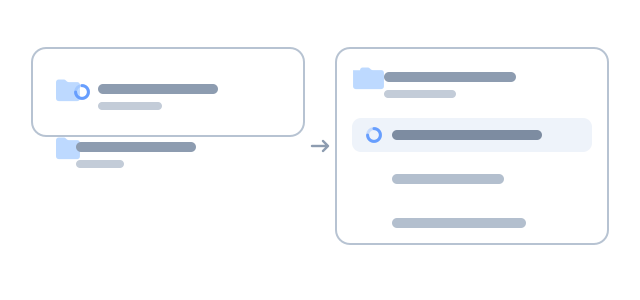

# Folded workspace running indicator (dsh-workspace-running-indicator)

A DSH plugin: **while a sidebar Workspace's Session list is folded, and anything inside that Workspace is still running, the Workspace row shows the shipped running spinner just before its name (right of the folder icon).** Expanding the list removes it and the spinner appears beside the running Session again.

## What it does

DSH renders its "running" ring only on Session rows. Fold a Workspace and those rows disappear, so a running task becomes invisible. This plugin lifts the same fact to the Workspace header row.

| State | What you see |
|---|---|
| Workspace folded, a Session inside is running | spinner appears left of the Workspace name |
| Workspace folded, only a subagent is running (parent idle) | spinner appears too, matching the Session row's own rule |
| Workspace folded, nothing running | nothing is drawn |
| Workspace expanded | the ring leaves the name row and shows beside the running Session only |
| The Session finishes | the ring disappears on its own, no reload needed |

## The same ring as DSH ships

The ring is not a look-alike drawing: its markup, size, stroke and animation are copied from the shipped `StateDot` in the `ongoing` state.

| Aspect | Parity |
|---|---|
| Size | 14px (the shipped running ring's size) inside the same 16×20 icon cell a Session row uses |
| Colour | `--dsw-alias-label-tertiary`, the very token the shipped ring uses, so both themes follow automatically |
| Motion | 1.5s linear rotation plus a 1.5s arc stretch; still under `prefers-reduced-motion` |
| Phase | the animation timeline is rewound on insert, so the ring turns in phase with every other shipped ring |
| Accessibility | the ring stays `aria-hidden` (as shipped) while a visually hidden status word names it, so screen readers report it |

The status word follows DSH's eight built-in languages (Chinese, English, Japanese, Spanish, French, German, Russian, Portuguese), reusing DSH's own `status.running` translations, and updates the moment you switch language.

## When it applies

- Only in the "by workspace" and "workspace tree" grouping modes — the two that render Workspace rows.
- The flat list and search results have no Workspace rows, so nothing is drawn there.
- A collapsed sidebar rail renders no Workspace rows either.
- The "Ungrouped" bucket is not a Workspace and is never marked.
- It coexists with presentation-only plugins such as workspace categories: hidden rows keep their ring and reveal it again when the category expands, with no extra refresh.

## Install

This is a local bundle. Either

1. **In the UI**: Settings → **Plugins** → **Add plugin**, then pick this directory; or
2. install this directory through the plugin manager.

The plugin then appears in the Plugins page as "Folded workspace running indicator". If the sidebar shows no ring right away, reload the page once.

## Compatibility

- Built against DSH **0.2.3-alpha.2** (the running version): the ring markup, theme tokens, sidebar slot and row anchors were checked against that release's source.
- Since DSH 0.2.3 the Session status table is the nested service `uiSession.sessionStatus`; this plugin declares both the parent service and that full dotted name in its Cordis `inject` (fixed in 0.0.3).
- **No `engines.dsh` is declared on purpose**: a DSH prerelease such as `0.2.4-alpha.1` satisfies no `^0.2.3-alpha.2` SemVer range, so declaring one would make DSH refuse to load the whole bundle. When this plugin cannot find its seam nothing breaks beyond the missing ring, so it is better to let it load on a newer DSH and update it then.

## Known limits

- It depends on the sidebar's current DOM: `data-row-key="workspace:…"`, `aria-expanded`, `projectText`, and two region anchors (`[data-slot="sidebar.workspaces"]`, `[data-sidebar-list-area]`). If a DSH upgrade replaces that structure the ring stops appearing; nothing errors, and one console warning (`the sidebar browsing region seam is gone`) points at the plugin.
- Archived filter: archived Sessions are excluded. Under the default "hide archived" filter that equals the visible rows; with "only archived" / "show archived" the folded ring and the expanded rows can disagree slightly.
- A folded Workspace with running work shifts its name 22px to the right (a 16px icon cell plus the 6px row gap). That is the unavoidable cost of placing the ring before the name; expanded or idle rows keep their exact position.

## How it works

- **Facts**: `uiSession.sessionStatus` (the snapshot the Session rows read), the Session list snapshot (pre-baseline fallback plus the subagent catalogs) and `workspaces.list` (membership and the archived set). Status is never guessed from the DOM.
- **Placement**: Workspace rows have no decoration slot, so the ring is inserted before the name cell of the row the Workspace browser renders, and re-inserted whenever React replaces that row.
- **Cost**: three snapshot subscriptions plus one MutationObserver that coalesces a single `requestAnimationFrame` pass when the sidebar region changes; streaming chat does not schedule work.
- **Lifecycle**: styles, dictionaries, subscriptions, observer and inserted nodes are all held by Cordis effects and removed when the plugin unloads.
- No Harness Client package is imported; only theme tokens and plain DOM are used.

## Changelog

### 1.0.0

Formal release:

- one version number everywhere, complete plugin-page metadata (English and Chinese title/description plus a detail image), MIT licence, bilingual docs and a release verification script;
- status word covers all eight built-in DSH locales;
- a second region anchor (`[data-sidebar-list-area]`) as a fallback, with a one-time console warning when both anchors disappear;
- behaviour and matching rules unchanged otherwise.

### 0.0.3 (2026-11-23)

DSH 0.2.3-alpha.2 compatibility: fixed the plugin-page error `cannot get property "uiSession.sessionStatus" without inject` (the status table became its own nested service, so both services must be injected), and added `@deepseek-ai/dsh-client-ui-session-status` to `dsh.client.inject`.

### 0.0.2

First long-lived version (recorded as 1.0.0 in the old README): the folded Workspace shows the shipped ring while a Session inside it runs or has a running subagent; expanding removes it; live updates; screen readers hear the running word.

### 0.0.1

First version, same behaviour.

## Verification

- Release check: `npm run check` — `verify` validates the manifest and shipped files, version consistency, locales, detail documents and image, artwork limits, and the client half's shipped constants and isolation rules; `test` loads the real `client.js` into a jsdom sidebar page and runs 11 behaviour cases (appears, disappears on expand/finish, subagent-only, archived, ungrouped, locale switch, re-render recovery, fallback anchor, unload cleanup).
- CI runs the syntax checks, `verify` and the behaviour suite on every push.
- Checked line by line against the installed DSH 0.2.3-alpha.2 source: ring markup and CSS, row anchors, sidebar slot and layout variables, and the `uiSession.sessionStatus` service.
- Visual behaviour was confirmed by the author in daily use; 1.0.0 changes only the fallback anchor, locales and release material.

## Licence

[MIT](LICENSE) © 2026 Rayzenchen
